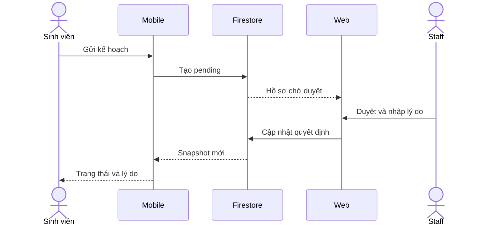

# Luồng duyệt kế hoạch học tập

1. Sinh viên mở **Dữ liệu học tập → Duyệt kế hoạch học tập** trên mobile. Chọn kỳ và nhập nội dung. Mobile tạo `study_plan_submissions/{uid}_{semester}` với `pending`. Rules đối chiếu UID, role, schema và timestamp.
2. Staff mở hàng đợi trên web, tìm yêu cầu, nhập lý do và chọn duyệt hoặc từ chối. Rules chỉ cho sửa bốn trường quyết định trên bản ghi pending.
3. Mobile nghe snapshot của các hồ sơ thuộc UID đang đăng nhập và hiện trạng thái cùng lý do. Không cần tải lại. Web có thể đăng thông báo chung qua `announcements`, đọc từ Trung tâm Thông báo → biểu tượng loa trên mobile.

Chạy ba lượt trên web đã deploy và Android. Ghi thời điểm web được xác nhận write, thời điểm mobile đổi trạng thái và hiệu số. Hiện chưa đo do cần ghép web.
