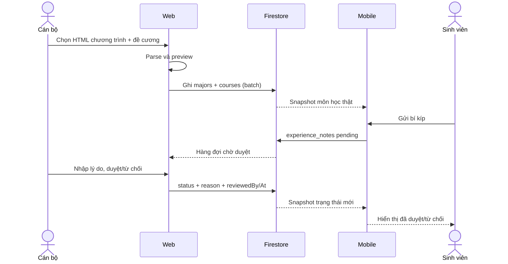

# Luồng nhập chương trình đào tạo và duyệt bí kíp

## 1. Cán bộ nhập chương trình từ FLM

1. Cán bộ mở **Chuyên ngành → Thêm chuyên ngành → Nhập từ file HTML FLM**.
2. Chọn 1 trang chương trình (có bảng `#gvSubs`) và các trang đề cương môn học (có bảng `#gvSchedule`). Có thể bỏ trống đề cương; môn vẫn được lưu ở trạng thái “chỉ thông tin chung”.
3. Web phân tích HTML ngay trên trình duyệt, hiển thị trước danh sách môn, cảnh báo thiếu đề cương/tiên quyết và cho phép bỏ chọn từng môn.
4. Khi lưu, web ghi một batch: `majors/{code}` và `courses/{code}__{courseCode}`. Môn đã tồn tại được cập nhật tại chỗ, không nhân bản.
5. Nhập thủ công dùng cùng mô hình dữ liệu: form chuyên ngành + form môn học (slot, đầu điểm, chuẩn đầu ra, giáo trình, nhiệm vụ/công cụ).

## 2. Sinh viên gửi bí kíp

1. Sinh viên mở chi tiết môn học trên mobile. Màn hình đọc `courses/{courseDocId}` đã được Admin nhập, không còn dữ liệu đề cương giả.
2. Sinh viên bấm **Gửi bí kíp**, nhập nội dung (tối thiểu 20 ký tự), gợi ý giảng viên, lưu ý thi PE/FE và mức độ hữu ích.
3. Mobile tạo `experience_notes/{id}` với `uid` của sinh viên, `status: "pending"`, `createdAt: serverTimestamp()`. Mỗi môn chỉ có tối đa một bí kíp đang chờ duyệt của một sinh viên.

## 3. Cán bộ duyệt bí kíp

1. Web quản trị nghe realtime toàn bộ `experience_notes`, hiển thị hàng đợi theo trạng thái.
2. Cán bộ mở một bí kíp, nhập lý do và chọn **Duyệt** hoặc **Từ chối**.
3. Rules chỉ cho cập nhật `status`, `reason`, `reviewedBy`, `reviewedAt` khi bản ghi đang `pending`; `reviewedBy` phải trùng UID người duyệt.
4. Mobile nghe snapshot gồm bí kíp `approved` của môn và bí kíp của chính sinh viên, nên thấy ngay trạng thái/lý do. Bí kíp đã duyệt hiển thị công khai và được dùng làm ngữ cảnh cho cố vấn AI.

## 4. Thông báo

Staff/Admin đăng `announcements` trên web; mobile đọc realtime trong Trung tâm Thông báo. Đây là kênh độc lập với hàng đợi bí kíp.

## 5. Ghi chú phạm vi

- Luồng duyệt `study_plan_submissions` cũ chỉ còn trên mobile (nếu bật), không còn trong web quản trị.
- Điểm số do sinh viên tự nhập trên mobile; Admin chỉ quản lý chương trình và môn tiên quyết.
- Nút **Dọn dữ liệu cũ** xóa `majors`, `courses`, `curriculums` sau khi gõ `XOA`; không đụng tới người dùng, thông báo hay bí kíp.
